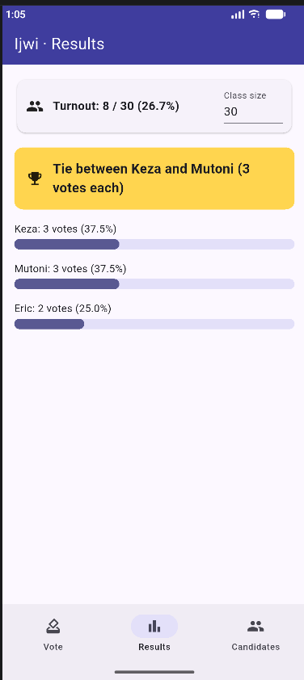
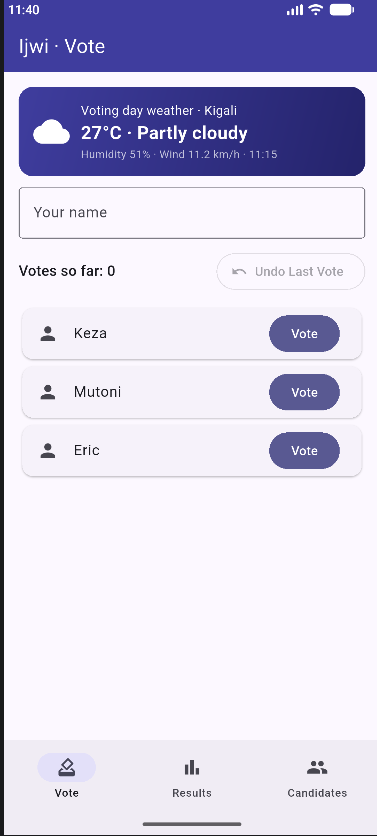
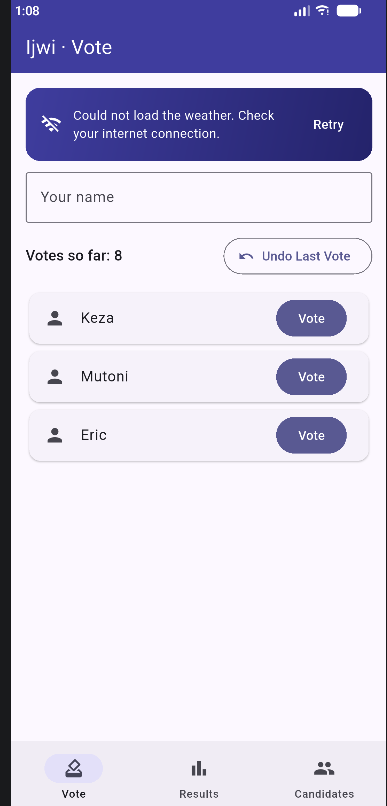

# Ijwi: Class Election

A Flutter app where the class elects its representative: names are cleaned, every voter votes only once, the results are ranked, and a tie is never shown as a fake winner.

My data is now saved on the phone with shared_preferences, so nothing is lost when the app closes, and it shows today's weather in Kigali from the Open-Meteo API.

## Screenshots








## What it does

- **Vote**: type your name and tap Vote on a candidate. Names are cleaned (`  aLINE ` becomes `Aline`), and each voter can vote only once. You can undo the last vote.
- **Results**: candidates ranked from the most votes to the fewest, with votes, a percentage with one decimal and a bar. A banner shows the winner or the tie, or "No votes yet". The turnout is shown against the class size.
- **Candidates**: add a candidate (not empty, not a duplicate), remove one who has no votes, or reset all votes after an "Are you sure?" question.
- **Saved on the phone**: the candidates, every vote, who already voted and the class size are saved after every change and loaded when the app opens.
- **Live API**: the Vote screen shows today's weather in Kigali from Open-Meteo, with three states: a spinner while loading, an error message with a Retry button when there is no internet, and the data.

## Think

**1. Why must names be cleaned before they are compared? Give an example of what goes wrong otherwise.**

A computer compares text letter by letter, so `aline`, ` ALINE ` and `Aline` are three different texts, even though they are the same person. Without cleaning, someone who already voted as `Aline` could type ` aLINE ` and vote a second time. The same happens for candidates: `keza` could be added next to `Keza` and the votes would be split between two entries. After cleaning (trim the ends, remove extra spaces, Title Case), they all become `Aline` or `Keza`, so they compare as equal.

**2. How does your app decide between a winner and a tie?**

It first finds the highest number of votes that any candidate has. Then it collects every candidate who has exactly that number. If only one candidate is in that group, that candidate is the winner. If there are two or more, nobody wins alone, so the banner says "Tie between ..." with their names and the shared score. With no votes at all, the banner says "No votes yet".

## Run it

```
flutter pub get
flutter run
```